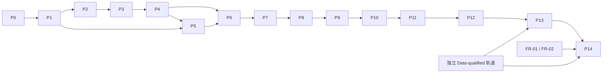

# 实施路线图

本页维护工作顺序与入口条件。系统设计见[架构文档](docs/architecture/overview.md)，
阶段结果见[当前状态](docs/status/README.md)，精确资格绑定见[发布记录](docs/releases/README.md)。

后续任务先读[实施与恢复约定](docs/guides/implementation-discipline.md)；
默认复用、局部影响与资源预算写在现有任务说明中，不另设开发门禁。
延误原因和改进依据见[HM-MVP 复盘](docs/hosted/hm-mvp-implementation-retrospective.md)。

## 当前落点

| 工作 | 当前范围 |
|---|---|
| P0–P7 | Offline Engineering 与 Data-qualified 工程发布完成 |
| P8–P13 | 已完成各自批准范围；不合并推导额外 Agent 能力 |
| FR-01 / FR-02 | P14 的 DSL 贯通与不可变 ResearchResult 入口已完成 |
| P14a / P14b / P14c | Ledger、有限候选枚举、有限工程选择资格完成 |
| P14d-A / P14d-B | 确定性编排与 synthetic 自主工程资格完成 |
| P14-DQ | 精确冻结输入和环境内工程资格完成；研究结果仍未进入选择 |
| P14 RC | 冻结于 `p14-rc-v1`，精确目标 `3a4a898`，生产基线 `e318dc4` |
| FR-03 / P14d-C | 本工作线 `0.162.1 + gpt-6.1-sol / medium` 资格 `GO`，main 未集成 / `BLOCKED_UNIMPLEMENTED` |
| HM-MVP component-v2 | `FROZEN`；tag `hm-mvp-component-v2` → `59c25ac`；有界工程交付完成 |

HM-MVP 当前接受的是固定 C15 的 component-v2 工程组合；精确身份、复用范围和限制见
[发布记录](docs/releases/hm-mvp-component-v2-freeze-marker.md)。两项科学结果均为 `SOFT_REJECT`。
P14 原资格继续绑定 `e318dc4`；RC 文档复审对象及冻结身份见
[P14 发布标记](docs/releases/p14-rc-v1-freeze-marker.md)。

## 下一项工作

HM-MVP 实施与发布交接已完成，目前没有必须重跑的验收或待完成的 HM09–HM11。
使用入口为[快速上手](docs/hosted/hm-mvp-quickstart.md)和[故障恢复](docs/hosted/hm-mvp-recovery.md)。
已完成 campaign 的调用额度已耗尽，后续运行需要新的授权与额度。

MCP 封装、standalone worker、其他 harness 或 SDK 重资格属于可选后续工作，
见[原始方案第9节](docs/roadmap/host-mediated-mvp.md#9-发布回退与后续工作)，由具体需求决定是否启动。
FR-03 确切后继已完成本工作线资格接受；默认 dependency pin 与 main 集成另行处理，
见 [FR-03 接受范围](docs/status/fr03.md)；
P14 主线的重开条件沿用其[发布标记](docs/releases/p14-rc-v1-freeze-marker.md)。

## 实施依赖

实现可以按依赖并行推进；阶段完成声明必须满足依赖的验收条件。

| 路线 | 详细验收条件 |
|---|---|
| P0–P7：确定性数据、研究、回测、验证与 Registry | [第一阶段](docs/roadmap/stage-one.md) |
| P8–P14：Evidence、proposal、admission 与有界 campaign | [第二阶段](docs/roadmap/stage-two.md) |
| FR-03：官方 Codex SDK/runtime | [冻结维护政策与重资格入口](docs/status/fr03.md) |
| HM-MVP：有界 Codex-hosted 工作流 | [当前交付与接受范围](docs/hosted/hm-implementation-progress.md)；[2026-09-29 原始方案](docs/roadmap/host-mediated-mvp.md) |

原始方案已作为 HM02 的历史审查输入绑定哈希，保留原字节。
其中“尚未实施”和模型分配属于2026-09-29提案时点，当前事实以发布记录和交付页为准。

## 范围约束

目标是 A 股日频 / 中低频研究。实盘交易、券商接口、分钟与 Tick 数据、
第二 canonical provider、基本面正式接入、动态 grammar、mutation/crossover 和多模型 Council
需要独立立项与资格门，均不由当前路线自动授权。

工程验收考察可审计执行与证据复现。收益软门拒绝可以是正确研究结果，盈利不是工程 DoD。

## 规则与设计依据

| 主题 | 规范入口 |
|---|---|
| 仓库硬性规则 | [AGENTS.md](AGENTS.md) |
| 后续实施、复用与恢复 | [实施约定](docs/guides/implementation-discipline.md) |
| Contracts、状态、哈希与不可变产物 | [Contracts 与 provenance](docs/architecture/contracts.md) |
| 采集、快照、时间语义与 PIT | [数据与 PIT](docs/architecture/data-and-pit.md) |
| Qlib、Signal、ResearchResult 与回测 | [研究与回测](docs/architecture/research-and-backtest.md) |
| Gate、稳健性、OOS 与 Registry | [验证与 Registry](docs/architecture/validation-and-registry.md) |
| Agent、Evidence、预算与 campaign | [Agent 与 campaign](docs/architecture/agent-and-campaign.md) |
| Go / No-Go 风险 | [风险登记](docs/reference/risks.md) |
| 历次 ADR | [决策索引](docs/adr/README.md) |

原 v14 的完整任务编号、阶段记述和旧验收结果保存在
[2026-09-29 文档快照](docs/history/2026-09-29/PLAN.md)。
该快照中的阶段状态按原提交解释。
