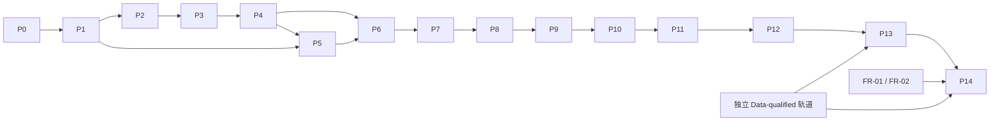

# 实施路线图

本页维护工作顺序与入口条件。系统设计见[架构文档](docs/architecture/overview.md)，
阶段结果见[当前状态](docs/status/README.md)，精确资格绑定见[发布记录](docs/releases/README.md)。

后续任务先读[实施与恢复约定](docs/guides/implementation-discipline.md)；
默认复用、局部影响与资源预算写在现有任务说明中，不另设开发门禁。
延误原因和改进依据见[HM-MVP 复盘](docs/hosted/hm-mvp-implementation-retrospective.md)。

## 当前落点

2026-10-12：FR-03 与 Discovery 后继实现已合入本地 main，见[合并审核](docs/reviews/two-worktrees-merge-20261012.md)。
各轨道的资格、科学结果和运行限制集中在[当前状态](docs/status/README.md)；
精确历史身份见[发布记录](docs/releases/README.md)。

Discovery 已完成两轮有界研究，第二轮按冻结规则建议暂停扩大当前空间同类 LLM 生成。
结果及 D01–D10 完成范围见[Discovery 状态](docs/status/discovery.md)，
设计、接口、阶段报告和实施历史见[研究文档索引](docs/roadmap/README.md)。

2026-10-12 后续授权的 A0 与 B0/B1 离线实施及集成准备已完成（未提交），使用入口见
[下一阶段索引](docs/roadmap/README.md#下一阶段离线实施)。2026-10-13 已授权 A1/B2 的所交付预算，
具体外发授权已复用；B2本次单LLM3补跑及报告收尾完成，科学结果为SOFT_REJECT。
A1 V4后继r10两步工程闭环完成，控制器/守卫exit0、清理核验通过；本轮两科学SOFT_REJECT，科学汇总FAILED/NOT_EVALUATED。累计SDK11/11、科学5次/90units，零重试、A保留约1.394GB≤4GiB。B2完成结果复用；原r9失败保留，不追加预算。
见 [A1/B2 当前准备状态](docs/status/a1-b2-authorized-preparation.md)。

## 后续工作与触发条件

| 工作 | 当前处理 | 启动条件 |
|---|---|---|
| 扩大当前空间的 LLM 生成 | 暂停扩大；本轮调用额度已耗尽 | 新研究理由、预声明比较设计及明确的新授权与额度 |
| D08 / N4b 预测专用窄路径 | 暂缓 | 既有成本证据能够说明可避免工作及实现收益；见[成本分析](docs/roadmap/post-hm-next-cost-analysis.md) |
| FR-03 后续部署或 SDK discovery/campaign 入口 | 尚未部署；该生成入口未资格化 | 针对实际使用需求、配置与接口完成相应范围的接入和验证；见[FR-03 状态](docs/status/fr03.md) |
| P14d-C | `BLOCKED_UNIMPLEMENTED` | 独立实现及资格化，不从 FR-03 GO 自动继承 |
| HM-MVP 运行扩展 | 既有 HM09–HM11 已完成 | 新运行或新能力需求；按[快速上手](docs/hosted/hm-mvp-quickstart.md)与[恢复手册](docs/hosted/hm-mvp-recovery.md)确定范围 |

旧执行队列、失败恢复和历史待授权记录按各自时点读取，不自动启动下一轮工作。
本地源码合并完成不表示全量 CI、覆盖率或新发布资格已通过；具体检查见合并审核。

## 实施依赖

实现可以按依赖并行推进；阶段完成声明必须满足依赖的验收条件。

| 路线 | 详细验收条件 |
|---|---|
| P0–P7：确定性数据、研究、回测、验证与 Registry | [第一阶段](docs/roadmap/stage-one.md) |
| P8–P14：Evidence、proposal、admission 与有界 campaign | [第二阶段](docs/roadmap/stage-two.md) |
| FR-03：官方 Codex SDK/runtime | [确切组合接受与使用边界](docs/status/fr03.md) |
| HM-MVP：有界 Codex-hosted 工作流 | [当前交付与接受范围](docs/hosted/hm-implementation-progress.md)；[2026-09-29 原始方案](docs/roadmap/host-mediated-mvp.md) |

原始方案已作为 HM02 的历史审查输入绑定哈希，保留原字节。
其中“尚未实施”和模型分配属于2026-09-29提案时点，当前事实以发布记录和交付页为准。

## 范围约束

目标是 A 股日频 / 中低频研究。实盘交易、券商接口、分钟与 Tick 数据、
第二 canonical provider、基本面正式接入、动态 grammar、mutation/crossover 和多模型 Council
需要独立立项与资格门，均不由当前路线自动授权。

工程验收考察可审计执行与证据复现。收益软门拒绝可以是正确研究结果，盈利不是工程 DoD。

## 规则与设计依据

| 主题 | 规范入口 |
|---|---|
| 仓库硬性规则 | [AGENTS.md](AGENTS.md) |
| 后续实施、复用与恢复 | [实施约定](docs/guides/implementation-discipline.md) |
| Contracts、状态、哈希与不可变产物 | [Contracts 与 provenance](docs/architecture/contracts.md) |
| 采集、快照、时间语义与 PIT | [数据与 PIT](docs/architecture/data-and-pit.md) |
| Qlib、Signal、ResearchResult 与回测 | [研究与回测](docs/architecture/research-and-backtest.md) |
| Gate、稳健性、OOS 与 Registry | [验证与 Registry](docs/architecture/validation-and-registry.md) |
| Agent、Evidence、预算与 campaign | [Agent 与 campaign](docs/architecture/agent-and-campaign.md) |
| Go / No-Go 风险 | [风险登记](docs/reference/risks.md) |
| 历次 ADR | [决策索引](docs/adr/README.md) |

原 v14 的完整任务编号、阶段记述和旧验收结果保存在
[2026-09-29 文档快照](docs/history/2026-09-29/PLAN.md)。
该快照中的阶段状态按原提交解释。
