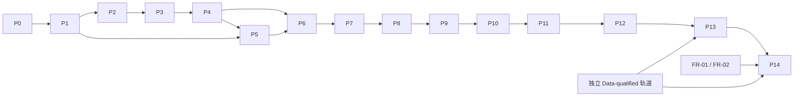

# 实施路线图

本页维护工作顺序与入口条件。系统设计见[架构文档](docs/architecture/overview.md)，
阶段结果见[当前状态](docs/status/README.md)，精确资格绑定见[发布记录](docs/releases/README.md)。

后续任务先读[实施与恢复约定](docs/guides/implementation-discipline.md)；
默认复用、局部影响与资源预算写在现有任务说明中，不另设开发门禁。
延误原因和改进依据见[HM-MVP 复盘](docs/hosted/hm-mvp-implementation-retrospective.md)。

## 当前落点

2026-10-22：公告理解试点离线工具及本地 Evidence Store 已提交本地 main `7d27c1f`，
见[源码采用范围](docs/releases/announcement-understanding-pilot-2026-10-22.md)。
16份已曝光材料的冻结整份成功均为0/16，38项事后人工复核已完成，不回写冻结分数。
工作区遗留文档及两份实验脚本的处理见[收尾审核](docs/reviews/workspace-review-2026-10-22.md)。

2026-10-20：[持仓缓冲对照](artifacts/holding-retention-20261020/run-01/report.txt)已完成。
固定20日收益率信号、周度Top50，唯一改动为前60名持仓保留缓冲；换手35.0089→30.5188、
费用约下降12%，仍未达原阈值12。净累计收益改善0.4240个百分点伴随毛结果下降及实际暴露变化，
不支持延长最低持有期或生产采用。新结果无完整Validation，`NOT_EVALUATED`，旧拒绝不变。
真实新候选→科学→反馈→后继决策仍待证，不能以诊断回测补记该闭环。
[本轮决策](artifacts/research-next-decision-20261020/decision.md)建议暂停新增同类实验，R5/R6继续暂缓；
唯一平滑候选仍属历史条件草案，尚不可执行，不自动发送旧准备指令或转移预算。
10月20日该轮仅整理文档与有限静态接口分析，详见[持久交接](artifacts/research-next-decision-20261020/handoff.md)。
脚本原字节与原证据保留；10月22日归档位置见上述收尾审核。

2026-10-19：新增[交付收敛与后续研究实施计划](docs/roadmap/quantos-delivery-consolidation-execution-plan-2026-10-19.md)
及[Codex 启动指令](docs/roadmap/quantos-delivery-consolidation-start-2026-10-19.txt)。R0–R4 已完成，
PR #4 普通合并为 `3c3ce8c80925b83bf424abbcecbd44ff4b30b446`，合并后 CI 成功，原持久目标已关闭；
见[实际交接](artifacts/delivery-consolidation-20261019/run-01/handoff.md)。操作入口见[交付说明](docs/guides/delivery-consolidation.md)。
R5/R6 离线准备及其持久目标也已完成，见[方案](artifacts/r5-r6-preparation-20261019/run-01/proposal.md)
与[交接](artifacts/r5-r6-preparation-20261019/run-01/handoff.md)，无需再次执行准备启动指令。
R5 因当前研究价值依据不足暂缓；固定平滑收益候选仅为条件方案，管理入口与正式运行包尚未形成。
R6 因可避免重复核验的独立成本不可观测暂缓修改，待下一项本来需要执行的任务顺带取得成本证据。
两项均未真实执行，不新开目标或沿用旧授权启动；具体重新进入条件保留在上述方案中。

2026-10-18：[首次 STOP 后闭合计划](docs/roadmap/quantos-adaptive-research-closure-plan-2026-10-18.md)的
N0–N3 已完成，源码绑定 `b0725b7`；获授权 N4 首次 STOP，SDK 1、新候选 0、科学 0，自动收尾通过。
见[主线采用与真实范围](docs/releases/adaptive-closure-integration-2026-10-18.md)。换手率问题未被实验回答，
真实新提案/科学/反馈后决策仍待证；`NOT_QUALIFIED`，终态包不自动续跑。

2026-10-18：[有界反馈研究计划](docs/roadmap/quantos-bounded-adaptive-research-plan-2026-10-17.md)的
AR0–AR5 源码与定向离线模拟已完成，采用 `5235445` 合入本地 main。首次真实运行只观察到首次 STOP：
1 次 SDK、0 个新候选、0 次科学，程序正常收尾；完整自动研究仍部分证明、`NOT_QUALIFIED`。
见[主线集成与首次 STOP 范围](docs/releases/bounded-adaptive-integration-2026-10-18.md)。
新候选科学闭环及本任务反馈后决策仍待真实验证；旧运行包已终态，不按旧提示词重跑。

2026-10-17：[两线计划](docs/roadmap/quantos-two-track-runtime-plan-2026-10-17.md)的最小有界版本
已完成 D0–D2、定向离线验证及本机正常路径的真实组合接受，固定运行源码为
`29fef56f303fa25ed19a82a7cc1286426d666df5`。两轮 SDK、两次科学/Validation、36 政策 units
完成反馈推进、receipt 结算和 cleanup；工程 `COMPLETED`，两候选 Validation 均 `REJECT`。
见[完成核对与固定身份](docs/releases/agent-runtime-bounded-v1-2026-10-17.md)及
[运行手册](docs/guides/agent-runtime-bounded-v1.md)。主线后继文档不改变运行身份。
本机保留环境和冻结两候选以外的安装/任务形状未接受；反馈改善、新候选研究、全部真实恢复窗口
仍未证明，P14d-C 不变。本次额度已耗尽；旧 handoff 和失败按原时点保留，不执行旧启动包。

2026-10-12：FR-03 与 Discovery 后继实现已合入本地 main，见[合并审核](docs/reviews/two-worktrees-merge-20261012.md)。
各轨道的资格、科学结果和运行限制集中在[当前状态](docs/status/README.md)；
精确历史身份见[发布记录](docs/releases/README.md)。

Discovery 已完成两轮有界研究，第二轮按冻结规则建议暂停扩大当前空间同类 LLM 生成。
结果及 D01–D10 完成范围见[Discovery 状态](docs/status/discovery.md)，
设计、接口、阶段报告和实施历史见[研究文档索引](docs/roadmap/README.md)。

2026-10-12 后续授权的 A0 与 B0/B1 离线实施及集成准备已完成（未提交），使用入口见
[下一阶段索引](docs/roadmap/README.md#下一阶段离线实施)。2026-10-13 已授权 A1/B2 的所交付预算，
具体外发授权已复用；B2本次单LLM3补跑及报告收尾完成，科学结果为SOFT_REJECT。
A1 V4后继r10两步工程闭环完成，控制器/守卫exit0、清理核验通过；本轮两科学SOFT_REJECT，科学汇总FAILED/NOT_EVALUATED。累计SDK11/11、科学5次/90units，零重试、A保留约1.394GB≤4GiB。B2完成结果复用；原r9失败保留，不追加预算。
见 [A1/B2 当前准备状态](docs/status/a1-b2-authorized-preparation.md)。

2026-10-15：R1c 固定比较完成并停止。共同720个定义日的 Rank IC 均值差 V−P 为
`-0.0053130521577256385`。原 V/P 请求均为 `EXECUTION_FAILED / QLIB_EXECUTION_FAILED`，
均无 ResearchResult/ValidationReport；V/P终态receipt各18政策units，合计36；剩余科学机会0。P2a继续暂缓。
这是固定候选与时期的回顾性探索比较，不改变 Validation/P14c 或任何资格判断；详见
[M最终核对与收尾](artifacts/evolution-implementation-20261014/coord/r1c-closeout.md)
及[实际比较交付](artifacts/evolution-implementation-20261014/runtime/r1c-comparison-final.md)。

后继 retained reader、CI 类型、pytest 入口及运行前置修复已集成，新增显式绑定的
[`compare-retained`](docs/guides/frozen-field-study.md#explicit-successor-retained-reader)；工程检查与发布核对见下列记录，未运行真实比较。
[结果契约设计](docs/roadmap/quantos-next-result-contract-2026-10-15.md)仍为提案，建议暂停新科学及成功语义改造。
精确集成提交、实际 CI 检查、main 合并身份与远端发布状态见
[本轮集成交接](artifacts/evolution-next-20261015/coord/final.md)。
发布采用[固定 runner 执行与隔离核对](ci/apparmor/runtime-guard.md)，不扩展科学资格；
实际 CI 与合并状态见[PR #3](https://github.com/Dedicatus547/quant-research-os/pull/3)。

## 后续工作与触发条件

| 工作 | 当前处理 | 启动条件 |
|---|---|---|
| 持仓缓冲后研究决策 | 固定对照已完成；换手/费用下降但换手仍超12，无完整Validation；建议暂停同类新增实验 | 见[决策](artifacts/research-next-decision-20261020/decision.md)：须有足以支持成本的具体新信息价值依据，再准备新任务/包/预算；不为补闭环强行运行 |
| 首次 STOP 后 N0–N4 | N0–N3 完成；N4 真实首次 STOP，见[集成记录](docs/releases/adaptive-closure-integration-2026-10-18.md) | 当前任务已终态；新实验须有具体研究理由、新包及新授权，不复用未用额度 |
| 有界反馈研究 AR0–AR5 | 源码已集成、定向离线模拟完成；真实首次 STOP 已核对，见[集成记录](docs/releases/bounded-adaptive-integration-2026-10-18.md) | 下一步补真实新方案/科学/反馈后决策证据；须有具体研究理由、新任务及预算，不强迫生成或重用旧额度 |
| 有界执行版 D0–D3 | 最小本机形状已完成，正常执行路径工程接受绑定 `29fef56`；见完成核对 | 下一任务先复用完成原件，核对支持形状并准备新的输入身份、独立输出、预算与外发授权；不重跑已耗尽 campaign |
| 扩大当前空间的 LLM 生成 | 暂停扩大；本轮调用额度已耗尽 | 新研究理由、预声明比较设计及明确的新授权与额度 |
| D08 / N4b 预测专用窄路径 | 暂缓 | 既有成本证据能够说明可避免工作及实现收益；见[成本分析](docs/roadmap/post-hm-next-cost-analysis.md) |
| SDK 新候选生成 | adaptive 显式后继已实现并模拟；旧 Discovery 入口仍阻断，真实生成/科学组合待证 | 在现有允许范围内提出可检验的新任务，按新预算补真实组合；不删除旧 blocker 或从首次 STOP 继承资格 |
| P14d-C | 仍 `BLOCKED_UNIMPLEMENTED`；与首版探索性工程接受分别判断 | 若申请该资格，明确后继接受义务；不从 FR-03、A1 或运行版发布自动继承，不改冻结契约 |
| HM-MVP | 保留冻结版本及兼容入口；业务组件供 SDK 复用 | 不另设持续扩建路线；新任务按[快速上手](docs/hosted/hm-mvp-quickstart.md)与[恢复手册](docs/hosted/hm-mvp-recovery.md)确定范围 |

旧执行队列、失败恢复和历史待授权记录按各自时点读取，不自动启动下一轮工作。
`d754652` 基线的 CI/覆盖率通过见上述集成交接；新提交的远端 CI 须按实际 checkout 单独读取，
不把基线通过重标成后继通过。这些工程检查不自动授予新的 runtime 或研究资格。

## 实施依赖

实现可以按依赖并行推进；阶段完成声明必须满足依赖的验收条件。

| 路线 | 详细验收条件 |
|---|---|
| P0–P7：确定性数据、研究、回测、验证与 Registry | [第一阶段](docs/roadmap/stage-one.md) |
| P8–P14：Evidence、proposal、admission 与有界 campaign | [第二阶段](docs/roadmap/stage-two.md) |
| FR-03：官方 Codex SDK/runtime | [确切组合接受与使用边界](docs/status/fr03.md) |
| HM-MVP：有界 Codex-hosted 工作流 | [当前交付与接受范围](docs/hosted/hm-implementation-progress.md)；[2026-09-29 原始方案](docs/roadmap/host-mediated-mvp.md) |

原始方案已作为 HM02 的历史审查输入绑定哈希，保留原字节。
其中“尚未实施”和模型分配属于2026-09-29提案时点，当前事实以发布记录和交付页为准。

## 范围约束

目标是 A 股日频 / 中低频研究。实盘交易、券商接口、分钟与 Tick 数据、
第二 canonical provider、基本面正式接入、动态 grammar、mutation/crossover 和多模型 Council
需要独立立项与资格门，均不由当前路线自动授权。

工程验收考察可审计执行与证据复现。收益软门拒绝可以是正确研究结果，盈利不是工程 DoD。

## 规则与设计依据

| 主题 | 规范入口 |
|---|---|
| 仓库硬性规则 | [AGENTS.md](AGENTS.md) |
| 后续实施、复用与恢复 | [实施约定](docs/guides/implementation-discipline.md) |
| Contracts、状态、哈希与不可变产物 | [Contracts 与 provenance](docs/architecture/contracts.md) |
| 采集、快照、时间语义与 PIT | [数据与 PIT](docs/architecture/data-and-pit.md) |
| Qlib、Signal、ResearchResult 与回测 | [研究与回测](docs/architecture/research-and-backtest.md) |
| Gate、稳健性、OOS 与 Registry | [验证与 Registry](docs/architecture/validation-and-registry.md) |
| Agent、Evidence、预算与 campaign | [Agent 与 campaign](docs/architecture/agent-and-campaign.md) |
| Go / No-Go 风险 | [风险登记](docs/reference/risks.md) |
| 历次 ADR | [决策索引](docs/adr/README.md) |

原 v14 的完整任务编号、阶段记述和旧验收结果保存在
[2026-09-29 文档快照](docs/history/2026-09-29/PLAN.md)。
该快照中的阶段状态按原提交解释。
