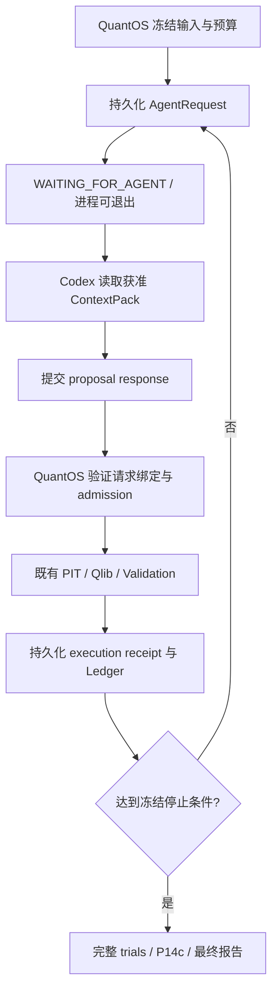

# Codex-hosted MVP 实施方案

日期：2026-09-29。状态：**PROPOSED / 尚未实施、审查或资格化**。

本文是 P14 RC v1 之后的独立变更提案。目标是通过持久化 Agent 请求／响应交接，
交付 Codex-hosted、有界、可恢复的研究工作流，使 MVP 交付不再等待 FR-03 上游修复。
本文中的类型、命令、状态和任务编号均为拟议设计，不能视为已经存在的接口。

## 1. 决策与交付边界

采用 **Host-mediated 协议 + Codex 宿主适配**。QuantOS 负责冻结输入、持久化状态、
proposal admission、预算、PIT、Qlib、Validation、Ledger 和最终报告；Codex 负责读取
获准上下文、提出结构化 proposal，以及请求继续执行。

MVP 产品声明为：用户启动一个 Codex 会话后，宿主驱动 QuantOS 完成一个冻结有限家族内的
研究 campaign；会话中断时，QuantOS 可以从持久化交接点恢复。宿主是否持续在线取决于宿主，
不承诺 standalone、无人值守调度或宿主自动重连。

| 路径 | 决策 | 理由 |
|---|---|---|
| 历史 CLI runtime / glue | 保留为 regression/reference | 历史 P10 9/9 仅覆盖当时配置，接入当前 P14 仍需新资格 |
| DSH / Pi 等 embedded harness | 后续 standalone 候选 | 尚未核验具体版本与能力，不能仅凭语义接近推断成本或资格 |
| Host-mediated | MVP 主线 | 复用既有请求、响应、driver、exchange 与确定性服务 |
| 直接 app-server JSON-RPC | 不进入 MVP 关键路径 | 仓库 D0.6 已在绕过 SDK wrapper 后重现观察缺口 |

官方 app-server 提供审批和事件接口，但这不能证明项目 FR-03 已解阻。
参见 [OpenAI Docs：app-server](https://learn.chatgpt.com/docs/app-server) 与
[ADR-0002 诊断记录](../adr/0002-official-codex-python-sdk.md)。

交付第一版只覆盖已有冻结候选家族，不扩展开放式因子搜索、动态 grammar、mutation/crossover、
sealed confirmation、实盘交易或新数据源。自然结果允许没有合格候选；盈利不是工程验收条件。

## 2. 基线、资格与变更管理

| 对象 | 当前基线 | 本提案处理 |
|---|---|---|
| P14 RC v1 | tag `p14-rc-v1`，目标 `3a4a898` | 历史冻结记录保留；实施分支记录完整起始 commit |
| P14d-B / P14-DQ 生产资格 | 精确绑定 `e318dc4` | 可复用组件；新组合不自动继承旧组合资格 |
| P14-DQ 工程 | `SUCCEEDED / PASS` | 沿用原范围说明 |
| P14-DQ 自然研究 | `FAILED / NOT_EVALUATED / SOURCE_INCOMPLETE` | 不改写为研究成功；不因此认定 snapshot 损坏 |
| FR-03 | `NO_GO / THIN_MAINTENANCE` | 原 SDK 轨道继续薄维护 |
| P14d-C | `BLOCKED_UNIMPLEMENTED` | 不以 hosted 资格替代原 live SDK 资格 |
| 新 hosted 轨道 | 尚不存在 | 建议命名 `HM-MVP`，单独契约、报告与接受记录 |

实施前完成 HM-01 的范围提案和 HM-02 的契约审查，明确新 hosted 路径的入口门及其对
ADR-0002“新 harness 使用 SDK”适用范围的修订。通过新增后继记录建立例外范围，
不静默修改历史冻结规则，不将 SDK 6/9 改写为 9/9。

依据：[P14 状态](../status/p14.md)、[FR-03 状态](../status/fr03.md)、
[RC freeze marker](../releases/p14-rc-v1-freeze-marker.md)。

## 3. 架构与复用



优先复用以下现有接口；HM-01 需按实施 checkout 核对实际调用链和变更点：

| 现有组件 | 复用方式 | 需要新增的能力 |
|---|---|---|
| `AutonomousAgentDriver` | 保留已有同步 driver 的使用路径 | hosted 编排增加可持久化等待结果，不让同步调用无限阻塞 |
| `AutonomousAgentRequest` / `AutonomousAgentResponse` | 复用 campaign、ContextPack、proposal 等业务绑定 | 对 hosted provenance 采用显式版本或独立 envelope |
| `AutonomousAgentExchangeStore` | 复用已完成 exchange 的不可变留存与核验思路 | 未完成请求、提交回执、attempt 及冲突证据 |
| `_validate_response` 与 proposal 校验 | 保留原 profile 严格语义 | hosted profile 采用独立的证据要求，禁止伪造 SDK manifest |
| `DeterministicResearchExecutionPort` | 继续调用 PIT / Qlib / Validation | 交接恢复与已有 execution receipt 的协调 |
| Campaign / Ledger / P14c | 继续有限家族、预算、完整分母与选择语义 | hosted transport 状态与业务状态的明确映射 |

实现入口见 [autonomous.py](../../src/quantos/application/autonomous.py)、
[Agent contracts](../../src/quantos/contracts/agent.py)、
[Autonomous contracts](../../src/quantos/contracts/autonomous.py)。
不先建设泛化的多 runtime 框架。CLI 和未来 MCP 使用同一个应用服务，不能各自实现 admission。

## 4. 交接契约与状态语义

### 4.1 请求与响应

请求至少绑定：schema version、campaign hash、run ordinal、request hash、candidate manifest hash、
ContextPack hash、明确输入 hashes、policy/budget hashes、允许的 proposal schema、请求大小上限。
允许读取的对象必须是冻结 allowlist 中的内容；宿主提交任意路径不产生读取权。

响应至少包含：schema version、request hash、attempt identity、proposal bytes/hash、可用的宿主
运行身份及其证据来源。QuantOS 自己重算哈希、检查 canonical serialization、schema、绑定和
admission，不信任宿主填写的 success、verdict、permission pass 或 usage 数字。

本地请求／响应文件只是传输工件。QuantOS 接收后才发布权威 receipt；发布工件不可覆盖。
同一 request 的同字节重复响应返回原 receipt，不重复执行；不同字节响应记录冲突并拒绝。
请求发布和响应接收采用原子写入及并发互斥／compare-and-set，具体方案在 HM-03 固定。

### 4.2 状态与恢复

下列状态属于新交接层，不能直接增加或替换现有研究 verdict：

| 交接状态 | 行为 | 对研究 accounting 的影响 |
|---|---|---|
| `REQUEST_READY` | 请求和预算预留已持久化 | 尚未形成研究 trial |
| `WAITING_FOR_AGENT` | 返回可恢复 checkpoint，允许进程退出 | 查询和等待不新增 attempt/trial |
| `RESPONSE_ACCEPTED` | 绑定与交接校验通过 | 尚不代表 proposal admission 或 Validation PASS |
| `EXECUTION_PENDING` | 进入已有确定性执行路径 | 依既有规则登记 trial 与 execution |
| `STEP_COMPLETED` | receipt、事件与 Ledger 已协调 | 可进入下一请求或最终报告 |
| `CANCELLED` / `EXPIRED` | 终止该请求的接收资格，迟到响应拒绝 | 保留 attempt/预算记录；不伪造研究 trial |

无效响应必须留存有界的拒绝 receipt 并计入提交上限；有 candidate 身份的业务拒绝如何形成
trial，沿用现有规则。没有可解析 candidate 的 transport 错误不虚构候选 trial，也不能无上限重试。
取消、超时和重新签发请求的预算关系在 trial 前冻结；重启不能重置预算或改变请求身份。

进程可能在接收响应、发布 exchange、执行完成、写入事件和更新 Ledger 的间隙退出。
恢复必须先对账已有证据，再决定继续步骤。目标是幂等的业务效果，不承诺物理执行恰好一次：
已有有效 receipt 应复用；无法证明完成的执行不得凭猜测标记成功，应按明确恢复策略停止或重试，
保留不确定尝试并计入预算。

### 4.3 预算与可观察性

QuantOS 可硬性控制请求／提交次数、proposal 字节数、候选数、trial 数、execution 数及自身执行预算。
请求发出前预留预算，完成后结算；异常和拒绝路径保留计数。

宿主内部 token、隐式重试和成本只有在可信宿主记录可获得时才能核验。缺失时标记 unavailable，
不能填零、复制请求配置作为有效策略证明，或宣称 token 硬预算已强制执行。若冻结的 hosted
契约要求 token 硬门而部署无法提供证据，则该 profile 不具备资格；不得运行后删除要求。

MVP 默认只声明 QuantOS 可验证的预算边界。attempt reservation 只能约束协议调用，不能证明
一个宿主请求内部只有一次模型调用。资格报告分别列出请求配置、宿主可观察身份、可信证据和限制。

## 5. 实际权限边界

宿主不得直接写权威 artifact / event / Ledger 存储，不得读取 sealed 数据或采集凭据。
运行研究的宿主与用于开发仓库的高权限 Codex 会话必须区分。

HM-06 采用固定部署 profile：QuantOS 服务在独立 OS 身份或等效容器边界内拥有权威目录，
宿主只获得只读输入投影和受限提交通道。服务使用冻结安装与配置，不执行宿主可修改的源码、
插件或任意命令；API 不接受任意执行路径、Python 代码或未授权的输出位置。
跨边界身份认证、路径解析、符号链接和大小限制均属于资格检查。

本地 CLI 可作为受限服务的客户端。如果使用相同 OS 身份直接运行、宿主可更改服务代码或写入
权威目录，该部署只能用于功能演示，不能授予强制隔离资格。不能用文件哈希代替权限隔离。

研究输入继续来自冻结 snapshot/Evidence；后续确定性阶段离线，不调用 Tushare 或 LLM。
模型服务网络调用仅发生于宿主提案阶段。所有日志和证据遵守凭据零输出、零持久化规则。
研究结果继续使用 Qlib 原有执行能力，MLflow 仅作 runtime recorder。

## 6. 工作分解与模型分配

下表中的实施模型是**开发这套软件时使用的模型**。`reasoning effort` 是推理档位，
“选择理由”解释性价比判断。独立审查使用独立上下文和明确输入工件，不要求并发多 Agent。
所有项初始状态均为 TODO；表中模型分配不代表已经运行或通过审查。

| ID | 工作与明确产物 | 依赖 | 实施模型 | reasoning effort | 选择理由 / 退出条件 |
|---|---|---|---|---|---|
| HM-01 | 基线审计、变更范围、接口差异表、hosted 契约草案及验收矩阵 | 无 | `gpt-6-sol` | `high` | 需理解跨模块绑定，Sol 承担主要分析；每项新声明都有证据来源与失败语义 |
| HM-02 | 契约与部署边界独立审查、后继 ADR 范围修订记录 | HM-01 | `gpt-6-astra` | `high` | 权威、预算和恢复遗漏返工成本高，集中投入一次强审查；阻塞项关闭后冻结契约哈希 |
| HM-03 | 版本化交接契约、pending store、原子发布、响应 receipt、冲突留证 | HM-02 | `gpt-6-sol` | `high` | 并发与不可变性需要较深推理；错绑、重复、冲突及崩溃窗口有明确行为 |
| HM-04 | 编排 suspend/resume、预算预留与结算、execution/事件/Ledger 对账 | HM-03 | `gpt-6-sol` | `high` | 核心状态机风险最高的实现项；重启不改变请求身份、不重复累计业务效果 |
| HM-05 | CLI 客户端、请求导出、响应提交、status/resume/cancel、宿主操作说明 | HM-04 | `gpt-6-sol` | `medium` | 薄接口但涉及应用接线，用 Sol 降低集成返工；CLI 不绕过统一校验 |
| HM-06 | 固定服务部署 profile、受限通道、输入投影、权威目录隔离、脱敏记录 | HM-02、HM-03 | `gpt-6-sol` | `high` | 实际 OS 权限决定边界是否成立；真实宿主越权读写被拒绝且有可核验证据 |
| HM-07 | 负例与故障注入、离线 verifier、既有 Scripted/Replay 回归 | HM-04、HM-05、HM-06 | `gpt-6-sol` | `high` | 测试需覆盖跨层行为而非镜像实现；完成第 7 节机械验收 |
| HM-08 | 固定输入的真实 hosted campaign、精确环境记录、第二根 replay 与资格 bundle | HM-07 | `gpt-6-sol` | `medium` | 按冻结规程执行与排错为主；得到真实交接证据和完整结果，不以手写响应冒充 live |
| HM-09 | 精确提交与 bundle 独立审查、hosted 资格接受记录 | HM-08 | `gpt-6-astra` | `high` | 最后一次跨层审查防止权限或资格过度声明；无未关闭阻塞项后才允许发布资格 |
| HM-10 | 快速上手、故障恢复手册、文档导航、发布范围与限制说明 | HM-09 | `gpt-6-luna` | `medium` | 已有批准事实，主要是有界整理；逐项链接接受记录，不自行扩张声明 |
| HM-11 | 发布工件核对、资格 hash 绑定、既有状态与新 hosted 状态登记 | HM-10 | `gpt-6-sol` | `medium` | 发布身份错误影响追溯，使用 Sol 做最终一致性核对；发布只覆盖新接受范围 |

关键路径：`HM-01 → HM-02 → HM-03 → HM-04 → HM-05 → HM-07 → HM-08 → HM-09 → HM-10 → HM-11`。
HM-06 是 HM-07 的必需前置，不能为了先演示而省略正式部署资格。
HM-07 的测试设计应在 HM-02 冻结，随实现逐项完成，避免最后集中发现契约缺口。

可分为三个可审阅交付切片：

1. **契约与离线交接**：HM-01 至 HM-04，能持久化请求并在进程重启后消费固定响应。
2. **受限宿主闭环**：HM-05 至 HM-08，能真实交接并完成固定 campaign，有独立 verifier。
3. **资格与发布**：HM-09 至 HM-11，接受精确工件，发布 Codex-hosted MVP。

不以日历工期替代退出条件。HM-01 完成后，依据现有 API 兼容性和隔离部署成本再估算工期。

### 6.1 模型成本依据与升级规则

以下为 2026-09-29 查询的官方模型页所列 API 文本价格，单位为美元／百万 tokens；
用于相对成本判断，不是 Codex 订阅配额或本项目总价承诺。

| 模型 | 输入 | 输出 | 分工依据 |
|---|---:|---:|---|
| [GPT-6 Luna](https://developers.openai.com/api/docs/models/gpt-6-luna) | 0.10 | 0.50 | 有界、重复、低风险文档整理 |
| [GPT-6 Sol](https://developers.openai.com/api/docs/models/gpt-6-sol) | 2.00 | 10.00 | 主要编码、集成与验证，兼顾能力和成本 |
| [GPT-6 Astra](https://developers.openai.com/api/docs/models/gpt-6-astra) | 10.00 | 50.00 | 契约和最终资格的集中审查 |

缓存、长上下文、服务档位和实际 reasoning token 消耗会改变费用；执行时以实际计费与
宿主可用模型为准。表中工作分配是基于任务风险的工程建议，未经本项目 A/B 成本实验验证。

- 默认使用表内档位，不将所有任务提升到 `xhigh` / `max`。
- Sol `high` 在明确复现问题上连续两次修复仍失败，或发现需要改契约，暂停盲目重试；
  整理最小复现、相关代码和已排除原因，交 Astra `high` 诊断，再由 Sol 实施批准修正。
- Luna 发现语义冲突、需要修改契约或解释资格边界时，交 Sol `high`，不让其自行裁决。
- Astra 仅审阅必要差异、契约和证据，不反复加载全量历史文档；实现模型也优先读取精确依赖。
- 每项记录模型、effort、尝试次数、可观察 usage 和结果，后续按成功完成任务的总成本调整分配。
  不可见的 usage 记为 unavailable，不估算后伪装成观测值。
- 所需模型不可用时记录替代决策；不能在资格执行期间静默切换模型或降低门槛。

### 6.2 MVP 宿主研究模型

建议首次新 hosted qualification 使用 `gpt-6-sol / high`，仅在有限候选与冻结上下文内生成提案；
它与 HM-08 的工程执行模型是两种角色，即使名称相同也分别记录。
通过后若要改用 `gpt-6-sol / medium` 或 Luna 降成本，另做固定任务集评估和新 profile 资格。
MVP 不引入动态模型路由或多模型 Council。

新 profile 记录实际可观察 model identity、配置哈希及不可变 snapshot 的可获得性。
模型名称不自动等于不可变模型快照；无法取得固定 snapshot 时明确限制，不宣称 live 文本可复现。
确定性复现绑定的是保存的响应字节和离线输入。原 FR-03 的 `gpt-5.6-sol`、9/9 rubric、
`max_attempts=1` 和 SDK/runtime pin 不由本建议改动。

## 7. 验收矩阵

所有 PASS 均来自实际观测和机械 verifier。LLM 可协助编写检查和解读证据，不能作为
normalization、PIT、模型执行、回测或 validation gate 内的判定器。

| 编号 | 必须覆盖的场景 | 接受标准 |
|---|---|---|
| Q01 | 无响应时 suspend、重启、重复查询 | pending request hash 不变，不新增预算消耗或 trial |
| Q02 | 相同响应重复提交／并发提交 | 返回同一接受 receipt，仅一个业务提交生效 |
| Q03 | 错 campaign、错 ordinal、错 ContextPack、过期请求、冲突响应 | 拒绝并留证，无确定性执行副作用 |
| Q04 | 超大输入、非法 schema、未知候选、越界 DSL、路径逃逸／符号链接 | 有界处理并拒绝，不能扩大候选家族或读取范围 |
| Q05 | 接收、发布、执行、事件、Ledger 各崩溃窗口 | 恢复先对账，完整保留 attempts/trials；不无证据宣称已完成 |
| Q06 | attempt、提交、trial、execution 预算耗尽，取消、超时及迟到响应 | 依据冻结策略停止，重启不重置，隐藏宿主成本限制被如实报告 |
| Q07 | 真实宿主试图写权威目录、读 sealed/凭据、修改服务代码、绕过入口 | 部署边界实际拒绝；服务身份与安装可核验 |
| Q08 | 人工填写 policy pass、usage、model identity 或缺失 transcript | 未经可信来源证明的字段不获得有效策略或运行时资格 |
| Q09 | 保存响应后离线 replay | 无模型/网络调用即可验证请求、响应、receipt、研究结果和事件绑定 |
| Q10 | 两个独立根的冻结输入与保存响应 replay | principal evidence 按明确规则一致；原始清单各自绑定；时间投影规则预先冻结 |
| Q11 | 真实 hosted campaign 至终态 | 至少一次真实模型提案交接；完整 accounting；自然拒绝可接受，PIT 为硬拒绝，执行失败为 FAILED / NOT_EVALUATED |
| Q12 | 既有 Scripted/Replay 与受影响确定性链路回归 | 不回退原边界，不以旧报告自动授予新代码资格；完成仓库适用检查 |

Q11 的工程接受只适用于完整执行与契约允许的自然研究终态。PIT 拒绝、执行失败或证据损坏
用例可以作为负例测试通过，但不因此把该 campaign 记为成功工程闭环。
若引用既有 P14-DQ 的合法软拒绝例外，必须在 HM-02 明确冻结它在 hosted 轨道的适用条件。

Q10 使用同一份保存的真实响应检验确定性部分，不要求两次独立 live LLM 输出相同文本。
Replay 不替代 Q07 实际隔离观测和 Q11 live 交接。

资格 bundle 至少包含：精确 commit、依赖锁与安装身份、环境／部署指纹、契约与 policies hashes、
输入 hashes、请求与响应、attempt／拒绝 receipts、execution receipts、事件链、Ledger、
ResearchResult、ValidationReport、适用的 P14c 报告、完整文件清单、限制与 verifier 结果。
宿主完整 transcript 不可获得时明确记录原因，不能把协议 exchange 命名为完整宿主 transcript。

## 8. 建议接口与实现落点

以下命令只表达预期能力；HM-05 结合现有 CLI 规范确定最终拼写：

```text
quantos hosted start    --spec <frozen-spec>
quantos hosted pending --campaign <campaign-hash>
quantos hosted submit  --request <request-hash> --response <response-file>
quantos hosted resume  --campaign <campaign-hash>
quantos hosted status  --campaign <campaign-hash>
quantos hosted cancel  --request <request-hash>
```

`start/resume` 推进到下一等待点或终态；`submit` 返回持久化 receipt；`status/pending` 为只读。
host 客户端只能将响应字节提交给服务，不能用客户端文件路径让服务任意读写其文件系统。
所有 canonical 参数绑定明确 hashes，不解析 mutable `latest/current/auto`。

建议 contracts 增加独立 hosted envelope/state；application 增加交接应用服务和编排等待出口；
infrastructure 负责存储、部署和传输；CLI 只调用服务。具体文件名由 HM-01 确定。
`quantos.contracts` 保持不依赖 SDK、Agent harness、Qlib 或 Tushare。

## 9. 发布、回退与后续工作

发布时创建新的 HM-MVP 接受记录与版本身份，公开列出“Codex-hosted、有限家族、可恢复交接、
实际隔离范围、可观察预算范围”。新状态引用新报告，不覆写 FR-03、P14d-C 或历史资格报告。

出现新路径缺陷时停用 hosted 入口，保留 pending、失败和已接受工件，回到已接受的离线
Scripted/Replay 产品范围；不自动回退到历史 live CLI，也不让旧程序消费未识别的新 schema。
修正产生新实现身份，按影响范围重做资格；安全相关契约变化需要新审查记录。

以下均为 MVP 后的可选工作，不是发布依赖：

| ID | 后续工作 | 实施模型 / effort | 选择理由与入口 |
|---|---|---|---|
| NEXT-01 | MCP 薄封装 | `gpt-6-sol / medium` | CLI 服务和协议稳定后复用既有能力，单独验证 transport 权限 |
| NEXT-02 | DSH / Pi 版本与能力调研、最小 qualification spike | `gpt-6-sol / high` | standalone 成为明确需求后，先查官方资料、固定版本并实测，再选择 harness |
| NEXT-03 | standalone worker adapter 与运行时资格 | `gpt-6-sol / high`；边界审查 `gpt-6-astra / high` | NEXT-02 通过后消费同一协议，新增认证、调度、恢复和预算证据 |
| NEXT-04 | 恢复官方 Codex SDK 重资格 | `gpt-6-sol / medium` | 仅满足既有 FR-03 触发条件时按冻结规程运行；工程模型不替换冻结实验模型 |

实施起点为 HM-01：固定 checkout，审计已有 driver/exchange/recovery/provenance 的复用差异，
输出可供 HM-02 审查的 hosted 契约与资格矩阵。本文本身不授予任何运行时或研究资格。
