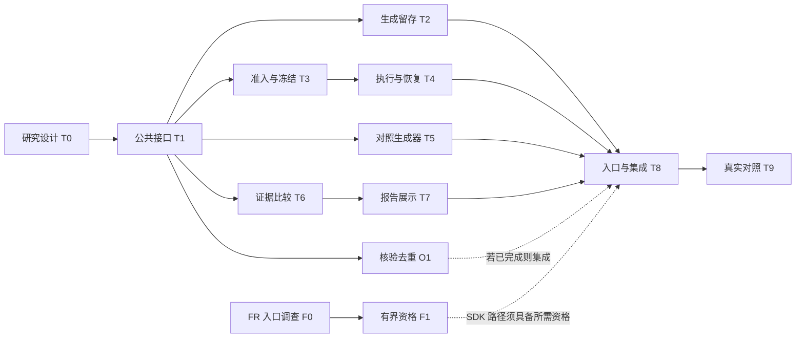

# HM-MVP 后续实施任务与模型分工

编制：2026-10-11。设计依据：[后续研究指南](post-hm-mvp-research.md)；实施规则：[实施与恢复约定](../guides/implementation-discipline.md)。

本文将首轮研究、运行时优化和FR-03拆为可单独交付的任务。2026-10-11本轮T0–T9、O0/O1及F0/F1有界任务已结束：15个生成机会冻结为10个不同候选，源码04按实际5交易日purge完成评价和只读比较；5个预测可分析，5个执行失败，策略Validation PASS为0。后继记账177单位，加旧已启动工作的保守承诺72为249≤360。作业05实际退出0，guard清理已核验。[首轮研究报告](post-hm-mvp-discovery-report.md)保留全部分母、指标、失败与成本；[实施记录](post-hm-mvp-implementation.md)保留旧停止/失败、来源采用和授权历史。FR-03的有界P10为7/9 NO_GO，未进入P13、未切换SDK。没有必须由用户操作的待办；后文未触发的后继任务不属于本轮完成条件。

后继评价上限288单位，旧已启动保守承诺72单位，合计不超过原360上限。旧初始预留177加恢复18合计195原样保留，不称实际支出或退款；旧计划中7个未启动任务为123单位。F1一次预检PASS，唯一P10 7/9 NO_GO；SDK分支停止，Hosted设施沿用明确范围，独立状态见[入口调查](post-hm-mvp-fr03-investigation.md)。实现与离线检查不授运行资格。

## 1. 模型分工与适用边界

**默认用 Sol 完成实现，用 Luna 承担明确的小任务，只有具体难点才升级到 Astra。** 优化目标是包含返工、上下文、复审和等待在内的总消耗，不要求每个任务先让最便宜模型尝试一遍。

官方文档将 `gpt-6.1-sol` 定位于兼顾能力与成本的复杂工作，将 `gpt-6-luna` 用于清晰、范围窄的子任务；较高 reasoning effort 会增加时间和 token 消耗。[模型与子代理配置](https://learn.chatgpt.com/docs/agent-configuration/subagents#choosing-models-and-reasoning) 以下逐项分配是结合本仓库依赖作出的工程判断，尚无本项目实测节省比例。

| 任务特征 | 建议模型 | 思考等级 | 使用方式 |
|---|---|---|---|
| 路径/引用整理、已确定字段的文档与展示修改 | `gpt-6-luna` | `low` 或 `medium` | 输入与目标明确，可机械核对；不交付新的研究或安全语义 |
| 接口已经确定的局部实现、简单基线生成器 | `gpt-6-luna` | `high` | 范围窄，遇到跨模块契约问题交回主协调者，不自行泛化 |
| 常规实现、集成、任务协调、FR-03 入口调查 | `gpt-6.1-sol` | `medium` | 默认开发配置；协调者主要处理依赖、差异与汇合，不重复全量阅读 |
| 研究设计、候选身份、证据核验、PIT/预算/恢复耦合 | `gpt-6.1-sol` | `high` | 直接交给有足够推理能力的模型，降低低配返工成本 |
| 已定位但仍难以解决的设计冲突、统计语义或恢复漏洞 | `gpt-6-astra` | `low` 起步，必要时 `medium` | 一次处理一个明确问题；输出决定与理由，常规编码交回 Sol |

`xhigh`、`max`、`ultra` 不作为默认配置。Astra 用于最困难的推理，Sol 与 Luna 分别侧重能力/成本平衡与效率，依据见[官方模型目录](https://developers.openai.com/api/docs/models)。本表不要求同时运行所有模型；当前工具可选范围不代表其他客户端、账户或冻结 runtime 已支持同样配置。

**三类模型身份分开：** 本表配置的是编写和审阅代码的开发代理；研究中的 LLM 候选生成模型、思考等级与重试预算由 T0 在生成前指定；FR-03 P10 则继续使用冻结的 `gpt-5.6-sol`、`max_attempts=1` 与原 rubric 9/9。不能用节省开发额度的分配覆盖研究设计或资格配置。

## 2. 首轮任务清单

路径省略 `src/quantos/` 前缀。表中路径表示主要所有权与影响核对入口，不要求全部修改；新增模块名称由 T1 确定。T0/T1 的决定写入现有任务记录即可，不新增形式化审批环节。

| 编号 | 交付内容与完成条件 | 依赖 | 模型 / 思考等级 | 主要文件或输出所有权 |
|---|---|---|---|---|
| **T0 研究设计与首轮取舍** | 定义固定 LGB 预测探索的主指标、方向、label、划分、可见信息、暴露历史、候选空间、对照和成本；选择复用完整执行或明确的窄 profile，以及候选集合组织方式 | 无；复用现有设计与证据 | `gpt-6.1-sol / high` | 研究指南相关任务记录；不改运行证据 |
| **T1 公共身份与接口** | 明确生成请求→原始提案→AST→准入→冻结批次/子任务→结果的引用关系；失败与重复可留存；生成请求不依赖未来 campaign；确定各任务接口和文件负责人 | T0 | `gpt-6.1-sol / high` | 所需后继 contracts；核对 `contracts/agent.py`、`contracts/proposals.py`、`contracts/enumeration.py`、`contracts/campaign.py`、`contracts/research_execution.py` |
| **T2 冻结前生成记录** | 实现请求/响应及解析失败、修订、无效/重复提案的持久留存和尝试计数；接入实际模型入口留到 T8，离线准备不冒充真实生成 | T1 | `gpt-6.1-sol / medium` | 新生成记录服务；现有 AgentRun 保存入口；公共 contracts 变更交 T1 负责人 |
| **T3 能力准入与候选冻结** | 按已选 DSL 子集检查字段、算子、窗口、PIT 所需来源和执行限制；形成可追踪候选映射与冻结集合/子任务，保留拒绝原因；旧枚举规则不改写 | T1；使用 T2 约定的记录接口 | `gpt-6.1-sol / high` | `application/proposals.py`、`application/enumeration.py` 及所需新准入入口；T2 不并行编辑这些文件 |
| **T4 执行、记账与阶段恢复** | 让选定候选表示进入实际执行；预算与步骤一致，PIT hard reject、失败留证及恢复明确；复用已有 receipt/Workflow，补齐实际需要的阶段出口 | T1、T3；接口稳定后可提前准备独立部分 | `gpt-6.1-sol / high` | `application/autonomous_execution.py`；按需适配 `application/autonomous.py`、`application/campaigns.py`、`research/qlib/workflow.py` |
| **T5 简单对照生成器** | 在同一允许空间实现已指定的模板/有限随机基线，固定 seed、尝试上限与来源，使用 T2/T3 公共入口；保留无效、重复及成本 | T1 的接口与 T0 的比较规则；最终接通 T2/T3 | `gpt-6-luna / high` | 独立基线生成模块；不改准入规则或研究指标 |
| **T6 预测证据准入与比较** | 从绑定产物核验数据、PIT、划分及 prediction/label；区分证据可分析、Validation PASS 与 P14c 可选择；保留原 verdict 与全部失败，确定比较报告的数据结构 | T0、T1；消费 T4 约定的结果接口 | `gpt-6.1-sol / high` | 新只读比较服务；复用 `research/qlib/result.py`，需要改 verifier 时协调 O1 所有者 |
| **T7 成本与报告展示** | 按 T6 输出展示主指标、来源、失败、重复和限制；确定性预算单位、实测资源、生成调用与人工投入分开，未知值明确标注 | T1 可准备结构；T6 接口确定后完成 | `gpt-6-luna / medium` | 新报告展示/导出模块及使用说明；不重新计算或裁定科学指标 |
| **T8 管理入口与集成** | 依研究指南第 5.5 节选择合格入口，接通生成、准入、执行与比较；新 profile 由管理侧选择，保留旧 v1；汇总局部检查与尚未验证项 | T2–T7；FR 线只在选用 SDK 时形成资格依赖 | `gpt-6.1-sol / high` | 所选 loader/管理入口；Hosted 路径涉及 `application/hosted_inputs.py`、`application/hosted_campaign.py` 等；共享契约由同一负责人合并 |
| **T9 有界真实对照与交付** | 在实际调用/运行授权和预算内生成候选，统一冻结后执行；输出可核验探索报告与实际成本，不要求科学 PASS 或盈利 | T8、具体输入和入口资格、可用预算 | 确定性脚本执行；协调 `gpt-6.1-sol / medium`，报告展示复用 T7 | 独立持久批次目录、运行记录与最终报告；实际生成模型按 T0，不由本行替换 |

**先选一条窄路径。** T0 优先评估“冻结比较批次引用合法子任务”和复用既有完整执行读取预测证据，选择总改造与运行成本更小的方式。若完整链成本明显不合适，再明确实现预测专用路径；不能两套同时开发以备选择，也不能假定现有 loader 已支持新子任务。

**不把任务名当作已有功能。** T1 需要先解决共享 candidate manifest 依赖：现有 Governor、Orchestrator、Execution Adapter 和 Hosted loader 都会消费旧枚举/家族规则。生成器、执行器和 loader 不能分别设计相互不兼容的新表示。

## 3. 与主线并行的任务

| 编号 | 范围、停止条件与完成边界 | 依赖与冲突 | 模型 / 思考等级 |
|---|---|---|---|
| **O0 已有成本记录整理** | 只读取有限日志/摘要，定位重复核验、执行和解析次数；记录可得指标及 unavailable，不为测量重跑完整流程 | 可与 T0 并行；避开大型工件重复解析 | `gpt-6-luna / medium` |
| **O1 同次结果核验去重** | 在同次操作内复用已捕获并核验的内容/事实，保留 canonical bytes、哈希、绑定与语义谓词；不扩为跨进程全局缓存，不预报加速比例 | T0 确定 profile、T1 确定结果边界后实施；`research/qlib/result.py` 为主要所有权，`application/autonomous_execution.py` 调用方改动与 T4 串行合并 | `gpt-6.1-sol / high` |
| **F0 FR-03 重开入口调查** | 核对是否存在符合政策的新官方候选或实质修复，整理候选 package/executable/provenance 核验材料及最小运行计划；无触发条件即保持薄维护 | 可与 T0–T7 的离线工作并行；不修改 canonical 锁定或启动 live turn | `gpt-6.1-sol / medium` |
| **F1 FR-03 有界重资格** | 在真实调用授权和预算内核验候选身份→一次 account/read 预检→成功后一次原 P10；失败停止，9/9 后才进入 P13；后续范围独立记录 | F0 满足重开条件；隔离 SDK 环境与输出；P14d-C 不自动解阻 | 命令按冻结程序执行；开发/诊断协调 `gpt-6.1-sol / medium`；P10 模型保持冻结配置 |

FR-03 精确状态、规则和原始记录以[维护入口](../status/fr03.md)为准。账号路由失败先按该政策停止；提高思考等级、换模型或增加 prompt 不能替代上游修复。

O1 不作为 T9 的无条件前置。若优化尚未稳定，研究可沿原有正确核验路径完成，记录真实成本；不能为赶进度减少核验。阶段恢复已经归入 T4，不再另设一队重复改造同一执行器。

## 4. 并行批次与文件所有权

默认**一个主协调者 + 两个执行代理**；独立任务充足、上下文与资源预算允许时才增加第三个执行代理，合计不超过本会话四个代理槽位。没有独立工作就不填满槽位。子代理只收任务所需上下文，不默认复制整段对话或整仓历史。

任务编号是交付边界，不要求每行新建一个代理。T1、T3、T4、T8 可由同一 Sol 负责人分段连续推进，复用对契约和执行链的理解；其他代理领取与当前阶段独立的任务，避免每次交接重新阅读全仓。

| 批次 | 推荐并行工作 | 汇合条件 |
|---|---|---|
| A：先决定范围 | T0 与 F0；O0 可作为空闲时的短任务 | T0 的研究问题与路径确定；F0 不阻塞研究设计 |
| B：统一接口 | T1 为主；O0/F0 尚未完成的只读工作可继续 | 生成身份、候选表示、结果结构与文件所有权明确 |
| C：分开实现 | T2 与 T3；O1 是可用的第三条独立线。完成一个再取 T5，避免开出过多长期任务 | T3 接口可供执行器使用；共享 verifier/adapter 改动进入单一合并顺序 |
| D：执行与分析 | T4 与 T6；T5 或接口确定后的 T7 可占用第三个槽位 | 执行结果、证据准入和报告能按同一身份链连接；T7 最终消费 T6 输出 |
| E：入口与必要核对 | T8 统一接线，并汇总 FR 线已获得的资格结果 | 首次真实生成前选择合格入口；只合并受影响、已获授权的验证 |
| F：真实批次 | T9；监测与报告复用已有工具 | 持久保存成功、拒绝、失败、实际退出与成本；共享权威写入有序 |

F1 不必等待批次 E：F0 确认重开条件，且授权、预算与资源就绪后，可与 B–D 的独立离线工作并行。F1 的 P10 通过也不自动授予 SDK 切换资格，所需 P13 等后续工作继续按 FR-03 的实际依赖单独安排；研究入口不因此无限期等待。

实线表示接口/结果依赖，准备工作可在已确定接口下提前进行；虚线不把 FR 或优化变成所有路径的前置。图不授予运行权限，F1 内部顺序不可并行跳过。

**同一文件一次只有一个写入者。** T1 所有者统一修改共享 contracts；T3 所有者负责 proposal/compiler 和枚举接入；T4 所有者负责执行器与恢复；O1 所有者负责 verifier，并将 adapter 差异交 T4 合并。T6 使用 verifier 公共接口，不另建一套较弱核验。T8 统一处理 loader、依赖锁及集成冲突。接口变动先通知消费者，不能让两个代理各自补一个版本。

独立代码任务可使用隔离 worktree/分支或清楚的文件分区；不复制大型科学工件来制造隔离。输入只读共享，运行输出分别持久保存。科学并行仍遵守既有 storage supervisor 的作业租约和实际 CPU、内存、宿主物理卷预算；开发代理数量不能用作 worker 数。

## 5. 节省额度与升级规则

1. **按任务派发，按差异交接。** 每次只给目标、已决定的接口、必要文件、禁止改动项、完成条件和有限阻塞；返回修改文件、完成证据与未解决项，不复述整份路线图。已完成结论由主协调者保存，后继代理按需读取。
2. **复杂任务直接用合适配置。** 身份、PIT、预算、核验和恢复直接用 Sol/high；不先用低配反复试错。机械修改先用 Luna，跨模块实现用 Sol/medium。
3. **升级解决问题，不重做整项。** 普通实现遇到局部逻辑困难可由 Sol/medium 升到 high；若仍存在具体设计冲突，提交最小相关代码和疑点给 Astra/low，必要时 medium。得到决定后交回原实现者，不让高成本模型接管整个仓库。环境、账户、额度或缺失输入问题先补依赖，不靠升级推理盲试。
4. **不默认重复审阅。** 普通文档与机械修改由协调者检查差异；高风险契约/恢复/核验变更在稳定时安排一次针对性复审，仅核对改动及实际依赖。已有审阅事实可复用，不设置每个提交都必须多模型签字的门禁。
5. **验证集中安排。** 子代理报告建议检查项和未验证限制；只有用户明确要求测试或实现验证时才新增/运行测试，由协调者合并重复项。科学执行、FR 资格和真实生成分别按已有授权与可用预算安排，不把离线检查当成已通过资格。
6. **额度按实际口径记录。** 区分开发代理消耗、研究生成调用与确定性执行资源；记录可取得的模型、思考等级、usage、墙钟时间和返工，无法取得时写 unavailable。不把 API 单价换算为未知的订阅额度，也不保证固定节省百分比。没有新增信息或可执行子任务时，结束子任务而不重复轮询/发起代理。
7. **只约束已能控制的配置。** 支持设置速度档位的新实施会话优先普通速度，不默认启用更耗额度的 Fast mode；具体额度差异以[官方速度说明](https://learn.chatgpt.com/docs/agent-configuration/speed#fast-mode)与账户实际计费为准。当前工具未暴露的配置不声称已经切换，也不为了本表改动全局 Codex 配置或冻结 runtime。

没有总额度数字时，本表不虚构 token/费用上限。执行时复用已有可用预算并在现有任务记录中明确批次上限；模型分工本身不扩大研究调用额度。FR-03 和研究生成各自的冻结重试规则优先，开发升级不能增加它们的尝试次数。

## 6. 观察到需求后才启动的任务

| 后继任务 | 启动依据 | 模型 / 思考等级 | 与首轮的关系 |
|---|---|---|---|
| OHLCV 字段、必要算子 | 首轮实际受表达能力限制，且来源/PIT 可闭合 | `gpt-6.1-sol / high` | 字段/compiler/PIT 由一位负责人协调；不因 view schema 已有字段就直接开放 |
| 多窗口扰动与预算语义 | 单窗口限制阻止明确研究问题，已定义扰动与记账含义 | `gpt-6.1-sol / high`；疑难语义可 `gpt-6-astra / low` | 不与首轮通用 AST 改造捆绑 |
| 信号/PIT 共享、进程并行 | O0/T9 记录显示真实重复成本或可并行瓶颈 | `gpt-6.1-sol / high` | 先减少重复计算，再安排资源受限的独立进程；共享权威写入保持有序 |
| 自适应 Discovery、正式预测选择 | 探索结果支持后继投入，已定义暴露历史和统计结论范围 | 设计 `gpt-6-astra / medium`；实现 `gpt-6.1-sol / high` | 属于新的研究设计；不把已消费数据改名为未暴露确认集 |
| LLM 推理特征及所需权限修订 | 具体方法需要，外传、知识时间、冻结输出与下游证据边界已明确 | `gpt-6.1-sol / high`；困难边界再升级 | 按研究指南第 4 节处理，不提前修改全局 LLM 权限 |

首轮交付止于 T9 的可核验探索报告及各独立工程任务的实际完成范围。未触发的后继任务保留为备选，不占用常驻代理、调用额度或首轮完成条件。
