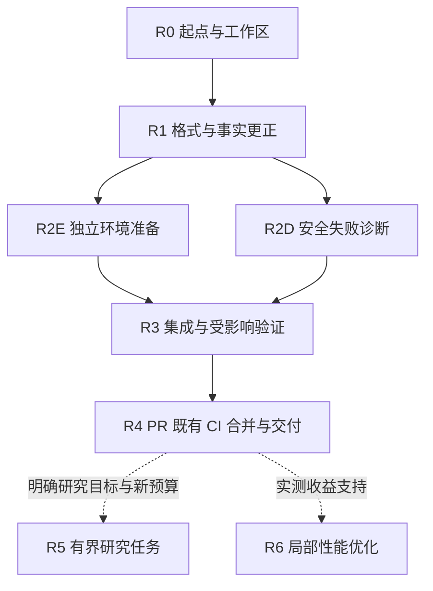

# QuantOS 交付收敛与后续研究实施计划

日期：2026-10-19。执行入口：[完整启动指令](quantos-delivery-consolidation-start-2026-10-19.txt)。

后继状态：R0–R4 已完成，原持久目标已关闭，见[实际交接](../../artifacts/delivery-consolidation-20261019/run-01/handoff.md)。
下文保留原实施范围与规划条件；不要再次执行已完成的 R0–R4 启动文件。
R5/R6 的独立准备目标也已完成，见[具体方案](../../artifacts/r5-r6-preparation-20261019/run-01/proposal.md)
与[准备交接](../../artifacts/r5-r6-preparation-20261019/run-01/handoff.md)。[准备启动指令](quantos-r5-r6-preparation-start-2026-10-19.txt)已执行，无需重跑。
当前两项均建议暂缓：R5 尚缺立即测量的价值依据及固定候选运行入口/正式包，R6 尚缺可避免重复工作的独立成本证据。
真实研究和优化均未执行，分别按第 7、8 节及具体方案的条件重新进入，不自动新开目标。

本计划先交付可维护的本机开发与运行准备流程：修复当前格式阻塞，补齐独立环境准备和安全失败诊断，完成受影响验证及源码发布。研究模型调用、市场数据采集、真实科学执行、部署和资格重建不在默认执行范围内。

使用一个 Codex 主会话负责调度、集成和收尾，最多同时运行两个子代理。用户发送启动指令后，Codex 连续完成默认工作包，不在每一步结束后询问是否继续。只有缺少实际权限、必要依赖不可取得、需要新增费用或确实超出任务范围时，才在完成其他可做工作后汇总具体缺口。

启动指令同时明确请求一个范围为 R0–R4 的持久执行目标。执行会话提供 Goals 工具时使用它，并遵守其实际预算及状态规则；未提供时继续正常执行并依靠第 6 节交接续接，不安装新的调度平台。目标和子代理都不能突破会话额度、审批或系统权限，也不保证断网、退出应用后仍自动运行。

本计划初次交付时只包含计划和启动指令；后继执行结果见页首交接。启动文件中的授权仅在用户将其发送给执行会话时生效。

## 1 依据与起点

执行前读取 [AGENTS.md](../../AGENTS.md)、[实施与恢复约定](../guides/implementation-discipline.md)、[当前状态](../status/README.md)和[审核记录](../../artifacts/project-review-20261019/review.json)。后续接手者只复核发生变化的依赖，不重新做全项目审核。

| 已确认事实 | 执行含义 |
|---|---|
| 审核代码基线为 `09edac2070aff4eaa2e13d5b803aee0a8cd08e6a`，当时本地与远端 main 一致 | 开始执行时记录实际 HEAD；若已前进，按差异调整任务，不回退 main |
| [该提交 CI](https://github.com/Dedicatus547/quant-research-os/actions/runs/39060721924) 在格式检查失败；后续 lint、类型、测试跳过，隔离检查和清理通过 | 首先修复已知格式问题；不把该次失败归因于 runner |
| 同锁版本 Ruff `0.16.5` 定位到 `autonomous_execution.py:787`，其余 795 文件格式通过；本地 lint 通过 | 只修此处；如后续源码已变化，先检查当前差异 |
| 默认 SDK extra 是 `0.154.0`，已接受运行使用显式 `0.162.1` 和本机保留环境 | 后继安装环境独立构建，旧默认、旧运行 checkout 和旧接受身份保留 |
| 部分 Workflow 失败仅有 `STAGE_EXCEPTION / UNCLASSIFIED` | 改善未来失败的定位，不重新裁决历史失败 |
| 两次 adaptive 真实任务各首次 STOP，候选与科学均为 0 | 新候选科学反馈链仍未证明，不重跑终态包凑闭环 |
| 当前空间没有观察到 LLM 相对最佳基线的正增量 | 新研究须有具体信息价值；扩大生成和长期分支搜索继续暂缓 |

审核证据位于主工作区 `artifacts/project-review-20261019/`，不随 Git 分发。7 份既有小型原件的哈希核对和局部证明保留原来源身份，不改标为本计划的全量通过。新环境缺少本机原件时，明确缺少哪一项及其影响，继续不依赖它的工作。

## 2 自动执行范围

以下权限以第 10 节完整启动指令被用户实际发送为前提。

| 自动完成 | 具体边界 |
|---|---|
| 本地源码、配置、文档修改 | 仅 R0–R4；保留用户已有改动和全部冻结原件 |
| 子代理分工和必要工作树 | 本节后的模型表与文件所有权；最多主代理加两个子代理，无递归委派 |
| 必要的实现验证 | 先用已有受影响用例；只为新增的重要行为补最小反例；不额外建开发门禁 |
| 独立环境准备 | 已有宿主、已有预算与存储守卫；优先已核验本地依赖，需要下载时仅取明确版本的公开发行包，不购买服务 |
| 本地提交及源码发布 | 专用任务分支、提交本任务文件、推送该分支、建立或更新 PR；现有 CI 通过且无未解决问题后普通 merge 到 main |
| 发布后收尾 | 读取实际合并提交及其既有 CI 结果，记录真实状态；无需部署或重跑科学 |

不包含：研究 SDK/LLM 调用、Tushare 采集、真实训练/回测/Validation、延长旧包 TTL 或借用旧余额、安装宿主 AppArmor 策略、修改仓库保护规则、force push、改历史 tag、删除证据、切换付费账户或 API key、购买额度。

开发子代理的模型消耗属于用户启动的开发会话，不能用“研究 SDK 调用为零”表示没有开发成本。默认使用 Standard 速度；不主动购买额度或升级速度。若实际客户端无法控制速度，报告实际档位，不伪称已切换。

GitHub 写入能力在 R0 就检查。当前审核环境未发现 `gh` 命令，已使用的 GitHub 连接器只证明读取可用，不能保证后续写入可用。优先使用执行会话已有的合法 Git/GitHub 接口；不得提取登录文件中的秘密来自行拼接凭据。若写入不可用，先完成本地提交、PR 标题正文和发布说明，再一次性报告所需连接权限，不空等、不反复尝试相同拒绝。

## 3 模型分工与思考强度

这里的模型分配用于开发 QuantOS，与冻结研究任务中的模型配置分开。不得据此更改研究包的 `gpt-6.1-sol / medium` 或 SDK/runtime 身份。

| 角色 | 模型与强度 | 工作范围 | 使用条件 |
|---|---|---|---|
| M 主代理 | `gpt-6.1-sol / medium` | R0，调度、接口决策、整合、R3–R4、状态和发布 | 整个执行会话只保留一个主代理 |
| L 小范围修改 | `gpt-6-luna / high` | R1 单处格式和明确的文档事实更正；之后可做只读链接与交付清单检查 | 任务明确、文件少；完成即结束，不常驻 |
| E 环境实现 | `gpt-6.1-sol / high` | R2E 依赖闭包、独立环境、版本和来源绑定、旧入口兼容 | 与 D 文件所有权分离后并行 |
| D 诊断实现 | `gpt-6.1-sol / high` | R2D 异常传播、类型化诊断、秘密保护、旧状态保留 | 与 E 并行；必须在 R1 释放共享源码后开始 |
| S 集成语义复核 | `gpt-6.1-sol / high` | 只读检查最终差异中环境绑定、失败传播及恢复边界 | 由已结束工作的一个 Sol 子代理承担，无需再创建常驻审查层 |
| X 疑难处理 | `gpt-6-astra / high` | 一项具体未解的来源、隔离或恢复语义矛盾 | 仅当 Sol 已给出复现事实和候选解释仍无法消除矛盾；默认不开 |

这是本项目的工程分配判断，不是模型效果基准。官方文档将 Sol 用于复杂多步骤工作、Luna 用于范围清楚的轻量任务；higher effort 适合复杂逻辑和边界检查。Astra 保留给真正困难的问题。依据见[官方模型说明](https://developers.openai.com/api/docs/guides/latest-model)和[子代理配置](https://learn.chatgpt.com/docs/agent-configuration/subagents)。

2026-10-19 本机模型缓存列出了以上三种模型及所用强度；账户当时和将来的真实可用性仍以执行时为准。显式设置子代理模型与强度，不依赖父会话默认继承。若委派接口要求以新上下文才能覆盖模型，使用新上下文并传入精简任务包，不复制整段历史。

Luna 不可用时允许 M 自行完成该小任务并记录替代。Sol 子代理不可用或客户端无法指定不同模型时，由 M 串行继续可承担的范围；复杂边界无法可靠处理时才提出具体阻塞。Astra 不可用不阻止正常交付；确有未解正确性问题时停止发布该改动，不能为了赶进度声称复核通过。默认不用 xhigh、max、ultra，也不为了使用所有模型而制造任务。

## 4 执行依赖和工作区



只需一个新的集成工作树，例如 `.worktrees/delivery-20261019-01`，任务分支例如 `work/delivery-consolidation-20261019-01`。实际名称由 M 检查冲突后确定并记录。已有 `.worktrees` 不作为空闲空间或可删除目录；原运行工作树不变。

启动时主仓可能仍有审核前的状态页改动和四份未跟踪诊断/规划文件，以及本次新增计划和索引修改。M 逐项辨认，不 `git add -A`、不 stash、reset 或清理它们。只将本次计划及其索引新增项移入任务工作树；其他未提交材料以主仓绝对路径只读引用，使用时记录身份，不擅自纳入提交。

默认在同一集成工作树按文件分工，避免另造多分支合并流程：

| 所有者 | 可写范围 |
|---|---|
| M | Git index/提交/发布、工作包状态、当前文档入口及最终冲突解决 |
| L | R1 期间的单处格式和 M 指定的事实性文档；完成后释放 `autonomous_execution.py` |
| E | 新的环境 profile/依赖锁、环境准备入口、必要的 package/preparer 接入和对应说明/用例 |
| D | `research/qlib/workflow.py`、必要的内部异常类型、`application/autonomous_execution.py` 诊断逻辑及对应用例 |
| S/X | 只读源码和指定原件，结果写各自管理目录 |

子代理不修改 Git index、不提交、不切换分支、不改另一个所有者的文件；发现需要跨范围修改时交给 M 排序。M 不与 worker 同时改共享文件，最终提交和 authority 写入串行。需要额外工作树时先说明真实隔离理由和空间，不默认复制运行环境或大数据。

常态并发为 M+E+D。环境安装、依赖全量库存、测试或其他较重磁盘作业最多一个同时执行；另一代理可继续编辑和小型只读检查。开始重作业前按既有 guard 核对真实宿主卷、完整增长、其他预留和收尾空间，不能只看 WSL `df`。

## 5 默认工作包

### R0 建立本轮执行起点

负责人 M，Sol medium。

1. 读取第 1 节入口、实际 HEAD、工作区差异、已有工作树及已有执行记录。若本计划已有已完成步骤，从未完成处续接，不复制新任务重复做。
   若已有同范围持久目标则采用它；否则按启动指令的明确请求创建一个。存在其他未完成目标时先核对身份，不替换或误标它；必要时继续可独立完成的工作并说明目标工具冲突。
2. 只查询当前提交相关 CI、目标分支及发布能力；不重复查询和下载整段历史。保留审核中失败 CI 的原身份。
3. 建立独立任务工作树和持久管理根 `artifacts/delivery-consolidation-20261019/<run-id>/`。原件引用使用绝对主仓路径，避免把新工作树中缺少的 `artifacts/` 当成原件丢失。
4. 在一份短 `handoff.md` 中记录实际基线、工作树、文件所有权、已知已有改动、安装来源、可用发布能力和执行范围。模型选择和替代也记在这里。

完成标准：下一步可以直接定位具体文件和证据；不需要创建新的治理平台、审批清单或多层验收报告。

### R1 修复格式阻塞并纠正当前事实

负责人 L，Luna high；M 审核差异。

入口：`src/quantos/application/autonomous_execution.py:787`、`docs/architecture/research-and-backtest.md`、已有当前状态入口和本次审核记录。

1. 核对目标代码仍有相同格式问题后，只对该文件应用锁定 Ruff 格式。确认差异限于排版；若出现其他逻辑差异，拆开处理。
2. 补充“默认 legacy profile 只支持 adjusted_close；frozen-field-study/v1 另支持 adjusted_volume”的准确说明，不扩大 adaptive grammar。
3. 将本轮发现写入简短的后继状态记录或当前入口。旧交接当时的 `in_progress` 保留；新增指向最终失败的更正，不改写历史运行文件。
4. 本步骤只做格式、lint、链接及 `git diff --check`；无需新增测试或重跑科学。源文件交给 D 前由 M 完成一次本地任务提交。

完成标准：唯一已知格式阻塞消除，原件和逻辑状态不变；不得提前写“主线 CI 已恢复”。

### R2E 提供可重建的本机环境准备入口

负责人 E，Sol high。

先读 `scripts/hosted_prepare_python.py`、`quantos.infrastructure.hosted_python_prefix`、既有安装库存/来源核验、`scripts/prepare_bounded_runtime.py`、`scripts/prepare_adaptive_package.py`、`application/adaptive_package.py` 及[运行手册](../guides/agent-runtime-bounded-v1.md)。复用既有准备、库存和 guard，项目新代码只补它们之间缺少的连接。

目标范围是当前已使用的 Linux x86_64/WSL 宿主形状、Python 3.11、SDK/runtime 0.162.1；交付可重复安装和离线准备，不授予新环境 live 资格。基础解释器、系统库和工具仍可作为显式宿主前提，不假装做到跨机器完全自包含。

具体交付：

1. 新的命名后继环境 profile，建议放在 `configs/runtime/bounded-local-01621/`，包含解释器/平台条件、科学依赖锁、SDK/runtime 包及二进制身份、Qlib 官方工具身份与明确安装来源。实际 schema/文件名在既有组件核对后确定。
2. 一个薄准备入口，优先扩展合适的现有入口；确需新增时建议 `scripts/prepare_runtime_environment.py`。预期支持只读描述、向新目录准备、核验已有准备三个操作。以上是待实现接口，不是当前可直接运行的命令。
3. 冻结科学依赖与 0.162.1 SDK 的独立完整解析结果，不能直接在默认 0.154.0 extra 上执行一次覆盖安装就称为可复现。优先使用已核验发行包；缺包才下载固定发行物并留来源/hash。不得复制包含登录态或凭据的运行目录。
4. 在新目录创建独立环境，排除隐式用户 site-packages 和历史 overlay；明确源码导入路径、运行 checkout、解释器、Qlib 工具和 SDK 二进制。若保留任何外部依赖路径，必须可定位、可核验且作为支持条件写出，不能宣称完全独立。
5. 让必要的 package/preparer 接入显式读取新 profile。新接口使用明确后继，旧入口保持原行为；不修改历史包、默认 `uv.lock`、全局 `.venv` 或已接受环境来迁就新入口。
6. 准备、核验期间不启动 provider、`runtime.run`、真实 Qlib 科学流程或 market acquisition。重用小型 synthetic/假 adapter 检查实际导入、固定版本、路径隔离、来源/hash 不符拒绝和准备失败留证。

完成标准：同一支持宿主上，可从固定发行物和声明前提重建环境并通过必要离线接线；输出实际命令、环境清单、未证明范围和恢复入口。缺少发行物时交付可用的准备实现与具体依赖缺口，状态为未完成安装验证；不能拿旧 `.pth` 方案改名交差，也不能为清单漂亮而复制大型数据。

### R2D 增加安全且可操作的失败诊断

负责人 D，Sol high。

主要入口：`application/autonomous_execution.py::_discovery_failure_diagnostic`、`research/qlib/workflow.py::_native_objects` 及异常出口、`research/qlib/universe.py::QlibResearchError`。

1. 先列出现有代码能够确定区分的失败触发点。当前已知的 required metric 非有限、recorder 输出接口缺失可作为候选；不推断 R1c 的唯一失败根因，不为凑分类覆盖未知第三方异常。
2. 为确有修复价值的触发点携带项目内部专用类型或固定诊断枚举，再由现有 stage completion 输出白名单细类。精确名字由实现决定，保持 `reason_code`、异常传播、科学 verdict、费用和恢复规则。
3. 不持久化任意异常文本、`repr`、第三方属性或完整 cause 链；未知错误继续 `UNCLASSIFIED`。外部字符串伪装成内部分类、未知 cause 和包含秘密的合成错误必须被安全处理。
4. 若现有 v2 的字段域足够，沿用现有格式；若确需改变公开契约，增加明确后继并保留旧 reader。不得扩展冻结成功语义、将 NaN/null 填零、把历史 FAILED 改成 SUCCEEDED。
5. 尽量复用现有报告入口，展示执行状态、研究 verdict、具体失败细类、父 selection 原因和已知用量。缺字段按缺失处理。只读历史查看不能为了获得更详细错误重新执行旧任务。

优先复用 `tests/unit/test_discovery_stage_diagnostics.py`、`tests/unit/test_qlib_workflow.py`，以及实际受影响的反馈/恢复节点。已有未知错误、失败原件保持、checkpoint 采用等反例继续有效；只为新增传播行为补必要用例。

完成标准：新产生的已知失败可确定定位，未知错误和旧文件兼容，原异常仍传播，失败不会发布成功 checkpoint，诊断不泄露秘密。无需产生新的真实科学失败来证明分类。

### R3 集成与必要验证

负责人 M；S 使用 Sol high 对具体集成差异复核。

1. 收齐 E/D 的实际差异、依赖说明、已执行检查和失败记录。停下所有 writer 后统一检查；不要让另一代理在验证期间修改源码。
2. 只对实际变动执行格式/lint、strict Pyright 和受影响用例。复用 R1/E/D 已完成且依赖未变的结果；若最终组合影响了它们，重跑相应节点，记录原因。
3. 重点确认新环境不会回落旧 SDK，准备入口不调用模型/科学，分类不改变 FAILED/REJECT，receipt-only 不执行科学、UNKNOWN 不重发，路径和秘密检查不放宽。
4. 真实 namespace 需要时只在既有支持和权限内使用。沙箱不支持时记录明确缺口，由已授权的既有 CI 承担对应检查；不在本机安装 CI 专用 AppArmor 策略，不把跳过记为通过。
5. 同一失败先修最小原因和受影响节点；只有修复或新证据支持才再运行。连续两次定向修复仍无法解释时，给 X 一个具体问题包，或报告阻塞；不得直接增加整套测试时限和资源。

候选用例不是必跑清单：环境/CLI 接线可选 `test_sdk_campaign_cli.py`、`test_adaptive_package_closeout.py`；恢复/反馈确有依赖变化时再选 `test_adaptive_runtime.py`、`test_adaptive_feedback.py` 中相关节点。源码阅读后才确定 node id，不能把文件名匹配当成全文件重跑理由。

完成标准：获授权检查的真实结果与最终源码依赖对应；残留风险可定位。局部验证不称为全仓或正式资格通过。

### R4 发布与交付

负责人 M，Sol medium；L 可承担明确的只读文档检查。

1. 用一页操作说明给出已实现的环境准备、检查、状态和只读收尾命令，标注本机支持形状。当前入口链接这份说明，历史长记录保持原位。核对原因码补差仍是“片段已验证、尚未采用”，除非确有本次有效新 recipe 采用证据。
2. 只提交本任务源码、必要用例、profile、计划和文档；市场数据、原始 provider 记录、环境安装副本和本地审核产物不上传。检查实际 staged diff，不能依赖 `.gitignore` 代替检查。
3. 推送专用分支、建立或更新一个 PR。PR 说明最终问题、行为、采用旧证明的范围、实际验证和限制，不复制全部过程日志。
4. 在稳定候选上使用仓库既有完整 CI，不额外在本地跑一遍同样的全套。R2 触及安装/异常传播和共享执行接点，最终组合需既有 CI 检查；这是本轮集成义务，不是因为单处格式变动就重跑资格矩阵。重复 push/PR 作业采用已有 concurrency 规则，取消不能算通过。
5. 若现有 runner 精确身份变化，保存差异并先完成其他工作。只形成具体后继环境建议；本计划不授权更改安全身份白名单或宿主策略。不能删除检查让 CI 变绿。
6. CI 通过后，核对实际 PR head、目标 main 新变动和未解决意见；无外部冲突且权限允许时使用普通 merge。只解决本任务范围内的冲突；无法判断的外部改动先保留并提出具体差异。
7. 保留合并提交和自动触发的 main CI 结果。若合并后失败，先读取有限失败信息，再在本任务范围内走后继修复，不回写旧通过、不 force 或自动回退其他人提交。若仅有 PR CI 结果，明确 main CI 尚未完成。

主仓有原有未提交内容时，不强行 pull/reset/checkout 来让本地 main 看起来同步。远端合并可完成，同时在 handoff 说明本地工作树仍保留用户修改及其真实 HEAD。

完成标准分开报告：离线实现是否完成、受影响验证是否完成、PR/合并/main CI 是否完成。发布能力缺失时交付本地 commit/patch 与具体 PR 材料，保持发布未完成；部署和研究资格均不由源码合并授予。

## 6 持久记录与中断续接

复用一份短 `handoff.md` 跟踪 R0–R4，链接已有结果。每个已执行检查保存命令、实际源码/环境身份、开始结束时间、真实退出与有限安全输出。运行输出使用独立 attempt 目录，历史失败不覆盖；新脚本失败也照实保留。不能持久化含秘密的原始异常或 provider 日志。

handoff 只需：实际 HEAD/分支/工作树、已完成步骤与来源、未完成项、下一条动作、仍在运行的进程/代理、已知资源预留和权限缺口。管理摘要可更新，正式证据不改写；不要为了这个计划建设通用 checkpoint 平台。

中断后先确认旧进程、锁和存储 lease 的实际状态，再继续。没有退出证据就写 unavailable，不能推断成功，也不盲目启动同一个重任务。接手者先读 handoff 和对应失败末段，按实际依赖复用结果，不重做全项目审核、完整环境库存或大文件扫描。

工作包的 `DONE` 仅指该包完成标准；`DEFERRED` 只用于 R5/R6 的未触发条件。R2 安装或 R4 发布未完成必须明确 `BLOCKED` 及具体依赖，不能改成暂缓来伪装本轮已全完成。这些是手工任务状态，不新增科学或 authority 状态机。

## 7 后续有界研究 R5

R5 不随默认启动指令执行，也不为了本计划自动生成研究包。只有用户明确提出研究问题后才进入，首先复用已有 STOP 诊断、结构映射和原因码片段。

1. 写清目标：判断是否值得探索，或测量指定结构的具体量。已有换手率问题可作为讨论起点，但不能因为未做过就认定值得花费。
2. 只选择具有独立理由且未被现有结果回答的问题，事先确定候选/允许空间、输入、比较对象、指标、停止条件、费用和宿主容量。保留全部历史曝光；新线程、新任务不使市场样本重新变成独立未见数据。
3. 需要相关新 recipe 时采用已验证的 `SOURCE_INCOMPLETE` 片段，核对冻结投影；保留旧 rationale 作为旧意见的身份，不静默删除负面事实诱导 PROPOSE。
4. 在实际新授权和预算内执行；科学 REJECT 可以回答具体测量问题。若目标是验证真实自适应链，必须观测同任务新提案、执行、真实反馈及后继决策；首次 STOP 如实结项，不反复抽样凑闭环。
5. 比较研究质量或成本时预先定义标准；PROPOSE 比例、候选数量和另一个 LLM 的偏好评分不能单独证明改善。

R5 的计划、模型/科学调用和执行义务在具体运行包中确定。本计划不给出新的调用次数或政策 units，不转移旧包未用机会，不开展上下文 A/B、长期分支搜索、P14d-C 或 sealed qualification。

## 8 局部性能优化 R6

R6 以[已有成本分析](post-hm-next-cost-analysis.md)为起点。下一次本来需要执行的工作可以顺带记录既有核验调用数和阶段开销；不为测量新增全量科学运行。

只有确认某个重复读取、核验或准备步骤的成本和可避免工作后，才实施一个局部优化。复用缓存需绑定真实源码、输入、schema/policy、配置、环境和 verifier，不能只比较文件名、mtime 或总 commit。优化接受要求是在相同科学谓词及证据范围下有可观察收益；没有数据就维持当前实现。

不默认开发预测专用新路径、通用依赖调度器、长期 worker 池或大规模模块重构。代码拆分仅随实际修改热点进行，避免把交付收敛变成新平台项目。

## 9 用户执行方式

### 方式 A 在当前应用开启一个执行会话

1. 选择项目 `/home/zjw/quant-research-os`，开一个新会话。
2. 选择 `GPT-6.1-Sol`，思考强度 `medium`，Standard 速度；保留受控的工作区权限，可用时选择自动审批审查。
3. 将[完整启动指令](quantos-delivery-consolidation-start-2026-10-19.txt)全文发送。它明确授权实施、必要验证、子代理、专用分支发布和条件满足后的普通合并，研究执行不包含在内。
4. 后续直接在主会话看进度，不需分别开 E/D/L 窗口。需要续接时使用第 11 节指令。

### 方式 B 终端启动

本机 `codex-cli 0.163.0` 的实际 help 已核对下列 `-C`、`-m`、`-c`、`--approve-for-me` 和 stdin prompt 用法。`--approve-for-me` 仍保留 workspace sandbox 与自动审查，不保证所有外部写入获准。

交互方式优先，便于在确有外部权限缺口时只处理一次：

```bash
codex -C /home/zjw/quant-research-os \
  -m gpt-6.1-sol \
  -c 'model_reasoning_effort="medium"' \
  -c 'agents.max_concurrent_threads_per_session=2' \
  --approve-for-me
```

启动后粘贴启动文件全文，或发送“请读取并执行 docs/roadmap/quantos-delivery-consolidation-start-2026-10-19.txt 的全部指令”。

已有权限和登录完整时，也可非交互启动；该命令会立即开始实施：

```bash
codex exec -C /home/zjw/quant-research-os \
  -m gpt-6.1-sol \
  -c 'model_reasoning_effort="medium"' \
  -c 'agents.max_concurrent_threads_per_session=2' \
  --approve-for-me - \
  < /home/zjw/quant-research-os/docs/roadmap/quantos-delivery-consolidation-start-2026-10-19.txt
```

这些参数只覆盖本次会话，不修改全局配置。速度在客户端中核对；命令不主动开启 Fast/Ultrafast。不同客户端可能不提供同一参数，以其实际 help 和权限策略为准，不能静默换成绕过 sandbox 的参数。非交互运行遇到不能自动处理的权限会失败并交回主任务，因此第一次推荐交互方式。[配置优先级](https://learn.chatgpt.com/docs/config-file/config-basic) · [子代理及权限](https://learn.chatgpt.com/docs/agent-configuration/subagents)

## 10 启动文件的执行约定

启动文件是唯一需要用户发送的完整提示词；它引用本计划，避免再维护一份任务清单。默认授权目标是 R0–R4 的实现、验证和源码发布。若只希望本地完成，在启动消息末尾明确追加：“本次仅本地实现、验证和提交，不推送、不创建 PR、不合并；交付可审阅发布材料后结束。”该用户限定优先。

模型子任务包由 M 自动产生，每份只包含：任务 ID、明确模型/强度、实际工作树与源码基线、可写文件、需读的具体入口、完成标准、验证权限、持久输出位置及禁止事项。不能把整段历史会话作为完成任务的必要输入。

M 接到结果后先检查实际 diff 和必要证据，不能将子代理自述 PASS 当作正式资格。复核与集成尽量由同一已有 Sol worker 承接；没有具体疑难就不调用 Astra。

## 11 中断后继续

优先恢复原 Codex 会话。若需新会话，在主代理 Sol medium 中发送：

```text
继续执行 docs/roadmap/quantos-delivery-consolidation-execution-plan-2026-10-19.md。
沿用我此前发送启动指令的 R0–R4 范围和仍适用的授权；先查找本计划的实际
artifacts/delivery-consolidation-20261019/<run-id>/handoff.md、工作树和运行状态。
只续未完成工作，核实依赖后采用已有结果，不重复已完成安装、测试或历史科学。
若多份 handoff 无法唯一确定当前任务，先基于分支、源码和实际进程核对；仍有歧义时问一个具体问题。
R5/R6 不自动启动；已有用户未提交改动和历史失败保持。
```

上下文压缩或会话切换不重置权限、预算和任务身份。账户额度用尽时保存交接，不另开账户或购买额度；恢复后从对应断点继续。

## 12 最终交付格式

执行代理最终只需给出：

1. R0–R4 每项完成状态、实际工作分支/提交、PR/合并身份。
2. 已交付环境准备和诊断命令的实际路径，以及本机支持条件。
3. 新增验证与复用证明各自范围、最终 CI 对应提交及仍未执行的检查。
4. 未解决问题和下一条具体动作；R5/R6 是否触发及原因。
5. 本机持久 handoff 链接；研究 SDK、科学和采集执行均应为 0，开发会话用量独立表述。

用户应能从这份短交付判断：源码是否已发布、环境是否能准备、失败是否更好定位、还有哪一步未完成。工程完成不表示策略盈利、研究改善或完整自主研究资格。

## 13 模型与工具资料

- [OpenAI 官方模型说明](https://developers.openai.com/api/docs/guides/latest-model)：模型能力定位；具体任务分配由本计划判断。
- [Codex 子代理](https://learn.chatgpt.com/docs/agent-configuration/subagents)：显式委派、模型与强度、并发和权限继承；子代理有额外开发用量。
- [Codex 配置](https://learn.chatgpt.com/docs/config-file/config-basic)：会话覆盖与配置优先级。
- [Codex 速度档位](https://learn.chatgpt.com/docs/agent-configuration/speed)：速度和用量的关系；本计划不承诺固定成本或节省比例。

资料读取日期为 2026-10-19。官方 API 默认、客户端默认和本机缓存可能不同，因此启动命令和子任务均显式指定模型/强度。安装的开发 Codex CLI 与项目冻结的研究 SDK/runtime 是不同对象，不能互相升级或替代。
